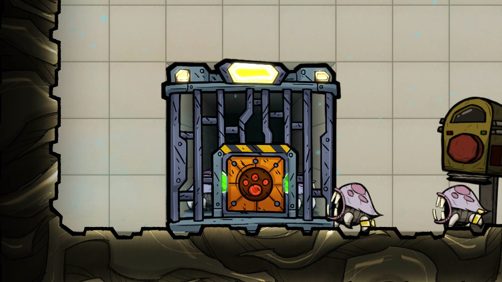
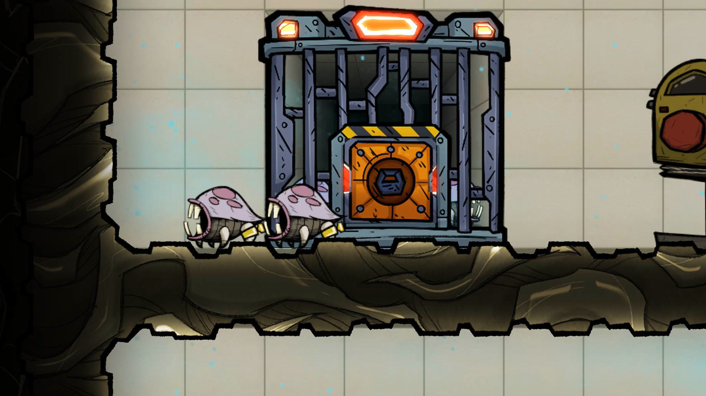

# Backrooms

> [!WARNING]
> **Very early alpha.** This mod is not on the Steam Workshop, and will not be until it is out of
> alpha. Install it by hand from the release zip. Expect things to break, and expect updates that
> cannot load saves made with an earlier version. Please report problems in this repository's issues.

Rooms that go back into the screen, for Oxygen Not Included. A Backrooms building sits on a patch
of backwall and draws a room that seems to continue behind the 2D plane: one-point perspective that
shifts with the camera, with a ceiling, side walls and floor that carry on what borders the opening.
The room lights itself, darker with distance from the opening, and light in the world at the
opening makes it brighter and reach further in.

The first room is the **Kennel**, a critter kennel built into a ranch room's back wall. Tame hatches
that would visit a Critter Condo walk in through its door instead. Inside they are no longer full
critters: their brains and pathfinding stop, they are drawn as sprites standing in the room, and
they keep eating from the Kennel's feed bin, pooping, laying eggs and counting toward the room. They
come out to be groomed and on at most two outings a cycle. So Backrooms is a visual mod and a
performance mod.

Built on the ONI Framework Library (`OniFramework.Library`), the part of the
[ONI simulation SDK](https://github.com/Salacious-Oni-Dev)'s API that runs on the game's own simulation.

## What it looks like

A camera tour of one Kennel in the project's test ranch. While a Kennel has room its top light is
yellow and the strips beside its door are green, so hatches walk in; once it is full, its lights and
strips turn red. Recorded by the automated run; the
[full run](https://github.com/Salacious-Oni-Mods/oni-backrooms/releases/download/v0.1.33/backrooms-run.mp4)
(2 min 20 s) also shows the whole test ranch, 306 hatches in 17 Stables, and the run's checks.

## Status

Alpha preview, version 0.1.33. The code is in `mod/`; `mod/README.md` has the details and every
known limit.

## What the Kennel is, and what comes next

The Kennel is the first use of the Backrooms technique, not the whole of it. The Kennel itself is
planned to take every critter type, not only hatches. The technique is intended for larger additions
too: full-room backrooms, with a new view that moves between layers and cuts a backroom into slices
one tile deep, so that duplicants can walk through it and build inside it. More uses are planned
beyond that like caves that can be entered and explored. These are plans, not promises.

## Requirements

- The `OniFramework.Library` mod, library version 1.3 or later, from the
  [oni-framework-api](https://github.com/Salacious-Oni-Dev/oni-framework-api) release 0.1.0-alpha.2.
  It does not need the `OniFramework` mod or the SDK's replacement `SimDLL.dll`. See
  [Installing and removing](https://github.com/Salacious-Oni-Dev/oni-sdk-docs/blob/main/guides/installing.md).
- No DLC.

## Using the Kennel

Build it from the Food menu, next to the Critter Condo, against a back wall inside a ranch room. It
stands on a floor and needs a tile or a backwall building (drywall, tempshift plate, ...) in every
cell beside it and above it; the build tool says which cell is open. Duplicants fill its feed
bin with Sandstone. A red signal on its logic port closes the door and lets every critter out. The
**Release all** button lets every critter out too; they walk back in on their own.

The front says what the Kennel is doing: the top lights are yellow while it has room and red while
it is full; the strips beside the door are green while hatches can walk in; the door shows a red
paw while the feed bin is empty and a padlock while the logic port is red.

## Performance

In a test ranch of 17 Stables with 18 hatches each (306 hatches) and 30 ranchers, adding one Kennel
to each pen cut the median frame time at speed 3 from 15.87 to 12.37 ms (-22%, about 63 to 81 fps),
three runs per arm on one PC. Your colony will differ.

## Known limits

- Save and load are not verified yet. Do not rely on the Kennel in a save you care about.
- A hatch using the door and the Kennel's lights changing over have been checked in the project's
  automated test worlds only, not yet in a played colony.
- Hatches only, and one room type so far.

## Testing

An automated run covers the Kennel in a test ranch of 17 Stables, each with a Kennel, 306 tame
hatches and 17 ranchers: every Kennel operational, hatches walking in on their own, the held hatches
kept fed and coming back out, and one Kennel's door opening and its top lights turning from yellow
to red as it fills. Its last run passed 24 checks with 0 failures. The run places the test ranch
from a blueprint instead of having duplicants build it. Save and load and a played colony are not
covered yet (see [Known limits](#known-limits)).

**By hand:** in a ranch room with tame hatches, build a **Kennel** from the Food menu against the
back wall, with a tile or a backwall building in every cell beside it and above it. Let duplicants
fill its feed bin with Sandstone. Hatches that would visit a Critter Condo walk in; the top light
turns from yellow to red once it is full. Press **Release all**, or send a red signal to its logic
port, and every critter comes out.

**Automated:** the runs are `mod/KennelRig.cs` and `mod/KennelBenchRig.cs`, built only with
`-p:BackroomsRigs=<path>/OniFramework/OniFramework.csproj` (see `mod/Backrooms.csproj`); they also
need the `OniFramework` mod from [oni-framework-api](https://github.com/Salacious-Oni-Dev/oni-framework-api).
On a development build of the game the test ranch is started with `--backrooms-bench-kennel`, and a
passing run ends its log with `RIG-VERDICT rig=BENCHK outcome=PASS` and `fail=0`. This run needs the
development build: the `--mod1-record` flag that filmed it is not part of the public Alpha 2, so the
by-hand recipe above is the one that works from these sources.

## Building

Clone [oni-framework-api](https://github.com/Salacious-Oni-Dev/oni-framework-api) beside this
repository and build it once with its `build.sh`. Then, with `ONI_GAME` set to the game's folder
(the one that contains `OxygenNotIncluded_Data`):

    cd mod
    dotnet build -c Release

The mod lands in `mod/bin/Release/`, with its `anim/` and `blueprints/`. The release zip carries
the same files.

## License

MIT, see `LICENSE`.

## Credits

Oxygen Not Included is developed and published by Klei Entertainment. This project is not
affiliated with or endorsed by Klei.
How this project follows Klei's modding guidelines, rule by rule: [COMPLIANCE](https://github.com/Salacious-Oni-Dev/oni-sdk-docs/blob/main/COMPLIANCE.md).

The room's faces show the game's own backwall art, read from your installed game at runtime; none of
it ships with this mod.

The Kennel art is by [MitBoy42](https://github.com/MitBoy42), made for this mod and used with his
permission (permission given in writing on 2026-10-11; the record is held privately by the project owner).

Development of this project uses AI coding assistants. All changes are reviewed, tested and
released by the maintainer.
